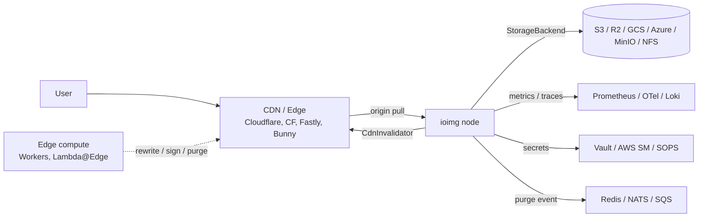

# Infrastructure Integrations — ioimg

Di mana ioimg dipasang dalam stack pelanggan. Integrasi framework ada di [`INTEGRATIONS.md`](INTEGRATIONS.md); dokumen ini fokus pada **infrastruktur**.

---

## 1. Prinsip

ioimg bukan pulau. Ia duduk di antara **origin storage** dan **CDN/edge**, dan berjalan di atas **platform** tertentu. Karena itu:

1. **Hulu fleksibel** — origin tidak harus HTTP. `s3://`, `gs://`, `az://`, `file://`, `smb://` didukung lewat trait `StorageBackend`.
2. **Hilir sadar-CDN** — ioimg harus tahu ia di belakang CDN mana, karena cache key & purge berbeda per vendor. Ini konfigurasi eksplisit, bukan asumsi.
3. **Runtime sadar-kemampuan** — io_uring tidak tersedia di semua platform (seccomp, gVisor, Firecracker). ioimg mendeteksi, bukan gagal.
4. **Ops-native** — Prometheus/OTel sejak awal; bukan "nanti".
5. **Tidak ada lock-in** — setiap adaptor punya minimal dua vendor yang teruji.



## 2. Matriks master

| Kategori | Integrasi | Bentuk | Prioritas |
| --- | --- | --- | --- |
| **Origin storage** | AWS S3, Cloudflare R2, MinIO, Backblaze B2, Wasabi, DO Spaces, Scaleway, OVH, GCS, Azure Blob, S3-compatible lokal (Biznet Gio NEO, IDCloudHost) | `StorageBackend` (SigV4 / native SDK) | P0 |
| Origin storage | NFS/SMB/local (`file://`), WebDAV, FTP(S) | `StorageBackend` | P1 |
| Origin storage | HTTP(S) generik + header kustom | `StorageBackend` | P0 |
| Origin storage | Google Drive (hanya file publik), Dropbox | `StorageBackend` | P2 |
| Origin storage | WebDAV / FTP(S) / SMB | `StorageBackend` | P2 |
| **CDN di depan** | Cloudflare, CloudFront, Fastly, Bunny, Akamai, Gcore, KeyCDN, Azure Front Door, GCP Cloud CDN | Konfigurasi cache key + `CdnInvalidator` (purge API) | P0 (Cloudflare, Bunny, CloudFront) |
| **Edge compute** | Cloudflare Workers, Lambda@Edge, CloudFront Functions, Fastly Compute, Deno Deploy, Vercel Edge, Netlify Edge | Snippet rewrite/sign/purge | P1 |
| **Reverse proxy** | nginx, Envoy, Traefik, Caddy, HAProxy, Kong | Config contoh + `sub_filter`/WASM | P1 |
| **Orkestrasi** | Kubernetes + Helm, Docker Compose, Nomad, systemd, Podman quadlet | Manifest & image | P0 |
| **Platform PaaS** | Fly.io, Railway, Render, Coolify, Dokploy, CapRover, Kamal, Koyeb | Dockerfile + catatan io_uring/seccomp | P1 |
| **Observability** | Prometheus, Grafana, OTel Collector, Loki, Datadog, New Relic, Sentry, Pyroscope, ClickHouse | Exporter + dashboard | P0 |
| **Auth/SSO** | OIDC (Keycloak, Auth0, Okta, Zitadel), Cloudflare Access, forward-auth | Validasi JWT di admin API | P1 |
| **Secrets** | HashiCorp Vault, AWS Secrets Manager, GCP SM, SOPS+age, Doppler, Infisical | Provider secret + reload | P1 |
| **Event bus** | Redis Pub/Sub, NATS, AWS SQS/SNS, Kafka, RabbitMQ | Purge fan-out, webhook | P1 |
| **TLS/DNS** | cert-manager, Caddy ACME, Cloudflare DNS, external-dns, Let's Encrypt | Auto TLS + DNS-01 | P1 |
| **Billing** | Stripe (metered), Paddle | Usage reporting | P1 |
| **Analytics** | ClickHouse, BigQuery, S3 log sink, Metabase/Grafana | Dataset request log | P2 |
| **CI/CD** | GitHub Actions, GitLab CI, ArgoCD, Flux | Build/test/deploy | P1 |

## 3. Origin storage (`StorageBackend`)

### 3.1 Pemetaan skema

| Skema | Backend | Auth |
| --- | --- | --- |
| `https://`, `http://` | `HttpOrigin` | opsional header kustom (terenkripsi) |
| `s3://bucket/key` | `S3Origin` (SigV4) | access key / IRSA / instance profile |
| `r2://bucket/key` | `S3Origin` (R2, region `auto`) | token R2 |
| `gs://bucket/key` | `GcsOrigin` | service account / workload identity |
| `az://container/blob` | `AzureBlobOrigin` | SAS / managed identity |
| `file:///mnt/media/...` | `LocalOrigin` | path root sandbox |
| `smb://host/share/...` | `SmbOrigin` | user/pass atau kerberos (P2) |
| `webdav://` | `WebdavOrigin` | basic/digest |

Satu project dapat mendefinisikan beberapa backend dengan alias:

```toml
[[project.storage]]
alias = "media"
kind  = "s3"
bucket = "acme-media"
region = "auto"
endpoint = "https://<account>.r2.cloudflarestorage.com"
path_style = false
credentials = { type = "env", access_key = "IOIMG_S3_KEY", secret_key = "IOIMG_S3_SECRET" }
prefix_allow = ["public/", "products/"]        # batasi prefix, wajib
```

URL publik: `https://acme.ioimg.dev/w_800,f_auto/media/products/123.jpg`

### 3.2 Kompatibilitas S3 (hal yang mudah salah)

| Vendor | Endpoint | Region | Catatan |
| --- | --- | --- | --- |
| AWS S3 | `s3.<region>.amazonaws.com` | eksplisit | `virtual-hosted-style` default; `path_style` untuk bucket bertitik |
| Cloudflare R2 | `https://<acct>.r2.cloudflarestorage.com` | `auto` | SigV4 wajib; **egress gratis** → kombinasi termurah dengan ioimg |
| MinIO | `http://minio:9000` | `us-east-1` (default) | `path_style = true` wajib |
| Backblaze B2 | `s3.<region>.backblazeb2.com` | region B2 | S3-compatible; ada batas kelas transaksi |
| Wasabi | `s3.<region>.wasabisys.com` | region Wasabi | minimum retensi 90 hari |
| DO Spaces | `https://<region>.digitaloceanspaces.com` | region DO | tanpa egress fee |
| Scaleway | `https://s3.<region>.scw.cloud` | region | |
| Azure Blob | — | — | bukan S3; pakai `AzureBlobOrigin` |
| GCS | `https://storage.googleapis.com` | — | punya XML API S3-ish; lebih baik native |

**Aturan implementasi:**
- Presigned GET maksimal 7 hari (SigV4) → untuk cache miss saja, jangan simpan.
- Gunakan `UNSIGNED-PAYLOAD` untuk GET agar tidak perlu hash payload (hemat CPU).
- Retry dengan backoff eksponensial pada `5xx`, `RequestTimeout`, `SlowDown`; **jangan** retry `403`/`NoSuchKey`.
- `Range` GET didukung: penting untuk gambar besar (mulai baca header dulu untuk dimensi, hindari unduh penuh bila hanya perlu metadata — hanya untuk format tertentu).
- Timeout connect 1 s, total 10 s untuk object storage (lebih longgar dari HTTP origin).

### 3.3 Keamanan storage

- Kredensial **per project**, read-only, `prefix_allow` wajib (tidak boleh akses root bucket).
- Kredensial disimpan terenkripsi (AES-GCM dengan master key dari env/Vault), tidak pernah di log.
- Rekomendasi ke pelanggan: bucket privat + kredensial hanya-baca + tidak ada listing.
- IRSA / Workload Identity didukung bila ioimg berjalan di k8s/EKS/GKE (tanpa secret statis).
- `LocalOrigin` wajib punya `root` dan penolakan path traversal (`..`, symlink keluar root).

## 4. CDN di depan (sadar-CDN)

### 4.1 Masalah utama: `Vary: Accept` tidak universal

`f_auto` mengandalkan `Vary: Accept` agar AVIF/WebP/JPEG tidak tertukar. Dukungan vendor **berubah dari waktu ke waktu** — tabel ini harus diverifikasi ulang per vendor sebelum dipakai di materi pemasaran.

| CDN | Dukungan `Vary` di cache key | Rekomendasi |
| --- | --- | --- |
| **Cloudflare** | ✅ **Didukung** (semua plan) via Cache Rules `Vary`, dengan aksi per-header `normalize`/`passthrough`/`bypass`. Ada juga "Vary for images" terpisah | Rule `Vary` dengan `accept → normalize` + `media_types` yang **mencakup `image/avif`**. Lihat peringatan di bawah |
| **CloudFront** | **Belum terverifikasi** (dokumentasi cache key tidak menyebut `Vary`; asumsi konservatif: hanya `Accept-Encoding`) | Format eksplisit di path, atau uji sendiri dulu |
| **Fastly** | Mendukung penuh (`beresp.vary`) | `f_auto` aman |
| **Bunny** | `Vary` terbatas; Optimizer punya konversi sendiri | Format eksplisit, atau matikan Optimizer untuk path ioimg |
| **Akamai** | Mendukung (konfigurasi cache key) | Perlu rule eksplisit |
| **Gcore / KeyCDN** | Terbatas | Format eksplisit |
| **Azure Front Door / GCP CDN** | Terbatas | Format eksplisit |

**Peringatan Cloudflare (footgun nyata):** pada aksi `normalize`, Cloudflare **menulis ulang** header `Accept` ke origin dan **membuang media type yang tidak ada di `media_types`**. Kalau `image/avif` lupa didaftarkan, ioimg tidak akan pernah melihat AVIF → semua user dapat WebP, tanpa error di mana pun. Selain itu `normalize` menghapus parameter `q`, jadi `f_auto` harus tetap benar hanya dengan urutan MIME type. `Vary: *` selalu bypass cache.

**Kesimpulan produk:**

- **Tanpa CDN**: `f_auto` + `Vary: Accept` aman dan disarankan.
- **Dengan CDN**: default kita tetap **format eksplisit** (`f_avif` / `f_webp` / `f_jpeg`) — bukan karena `Vary` mustahil, tetapi karena satu vendor yang salah konfigurasi menghasilkan gambar rusak di produksi. Jalur `f_auto` + `Vary` menjadi opsi yang didokumentasikan per vendor, lengkap dengan checklist verifikasi.
- Untuk setiap CDN, quickstart wajib menyertakan **cara memverifikasi** (cek `Content-Type` untuk 3 user-agent berbeda), bukan hanya konfigurasi.

### 4.2 Konfigurasi cache key yang benar

```
Cache key minimal (CDN):
  host + path                                     # semua ops & source ada di path
  + Accept-Encoding (built-in)
  (Vary: Accept hanya bila CDN mendukung dan f_auto dipakai)

Jangan masukkan ke cache key:
  X-IOIMG-* (header debug), Cookie, User-Agent, query utm_*
```

Header yang harus diteruskan ke origin: `Accept`, `Accept-Encoding`, `Range`, `If-None-Match` (opsional).
Header yang **tidak** boleh di-cache: `Set-Cookie` (ioimg tidak mengirim), `Authorization` (kecuali admin API).

### 4.3 Purge fan-out (`CdnInvalidator`)

`POST /v1/purge` di ioimg menghapus L1/L2 **dan** mem-fan-out ke CDN:

```toml
[[project.cdn]]
provider = "cloudflare"
zone_id  = "abc123"
api_token = { type = "env", var = "CF_PURGE_TOKEN" }
purge    = ["tag", "url"]      # pakai Cache-Tag bila memungkinkan
```

| Provider | API | Batas | Catatan |
| --- | --- | --- | --- |
| Cloudflare | `POST /zones/{id}/purge_cache` (URL/tag/everything) | 30 URL/req, 1000/hari (free) | Pakai `Cache-Tag` untuk purge massal |
| CloudFront | `CreateInvalidation` | 1000 path/req, 1000 gratis/bulan | Invalidasi = biaya & latensi; pakai versioned path |
| Fastly | `PURGE` / `surrogate-key` | — | `Surrogate-Key` paling efisien |
| Bunny | `POST /pullzone/{id}/purge` | — | by URL atau everything |
| Akamai | CCU API | 500/bulan (fast purge) | Mahal; hindari |
| Gcore / KeyCDN | API purge | — | |
| Azure Front Door | `purge` endpoint | — | |
| GCP Cloud CDN | `invalidateCache` | — | |

**Desain:**
- ioimg mengirim `Cache-Tag`/`Surrogate-Key` di response (mis. `project:acme`, `src:<hash>`), sehingga purge per aset/tenant murah.
- Purge bersifat **best-effort + idempoten**; kegagalan CDN dicatat di job log, tidak menggagalkan purge lokal.
- Untuk aset immutable, strategi utama adalah **versioned path** (`/v2/...` atau query `?v=`) — bukan purge. Purge hanya untuk kasus "gambar salah upload".

### 4.4 Header yang dipakai ioimg untuk CDN

| Header | Guna |
| --- | --- |
| `Cache-Control: public, s-maxage=31536000, immutable` | Varian immutable |
| `Cache-Tag` (Cloudflare/Fastly-compatible) | Purge selektif |
| `Surrogate-Key` (Fastly) | Purge selektif |
| `X-Cache-Key-Version` | Diagnostik saat mengubah skema key |
| `CDN-Cache-Control` | Override TTL khusus CDN |
| `Vary: Accept` | Hanya bila didukung |

## 5. Edge compute

| Platform | Kemampuan | Pola |
| --- | --- | --- |
| Cloudflare Workers | request/response penuh, KV, R2 | rewrite HTML (`HTMLRewriter`), sign URL, purge trigger |
| Lambda@Edge | viewer & origin request/response | rewrite `src`, tambah `Cache-Tag` |
| CloudFront Functions | **hanya viewer** request/response (ringan) | normalisasi query, redirect, tambah header |
| Fastly Compute (WASM) | full | sign + rewrite + purge via surrogate key |
| Vercel Edge / Netlify Edge | middleware | rewrite ke ioimg, sign di edge |
| Deno Deploy | full | proxy + sign |

Catatan penting:
- **Jangan** menaruh signing secret di edge publik kecuali platform mendukung secret store (Workers Secrets, Fastly Config Store).
- Untuk signed URL dari edge, gunakan **key terbatas** (scope `sign-only`, hanya untuk host tertentu) agar kebocoran tidak membuka admin API.

Contoh Workers (rewrite + sign):

```js
export default {
  async fetch(req, env) {
    const url = new URL(req.url);
    const img = url.searchParams.get("u");
    if (!img) return fetch(req);
    const ops = `w_${url.searchParams.get("w") || 800},f_${acceptFormat(req)},q_auto`;
    const exp = Math.floor(Date.now() / 1000) + 3600;
    const canonical = `${ops}/${img}?exp=${exp}`;
    const sig = await hmacB64url(env.IOIMG_SIGN_KEY, canonical);
    return fetch(`${env.IOIMG_BASE}/${sig}/${ops}/${img}?exp=${exp}`, { cf: { cacheEverything: true } });
  },
};
```

## 6. Orkestrasi & platform (dan dukungan io_uring)

**Tabel paling penting di dokumen ini** — karena io_uring adalah nilai jual, operator harus tahu di mana ia hidup.

| Platform | io_uring | Catatan |
| --- | --- | --- |
| Bare metal Linux ≥ 6.1 | ✅ | Terbaik; gunakan CPU pinning |
| VM KVM (Hetzner, OVH, DO Droplet, Vultr) | ✅ | Umumnya tersedia |
| Kubernetes (containerd) seccomp `RuntimeDefault` | ❌ | `io_uring_enter` diblokir → perlu profil `Localhost` |
| Kubernetes seccomp `Unconfined` / profil kustom | ✅ | Default Helm chart: `uring` profile opsional |
| Docker (profil seccomp default) | ❌ | Perlu `seccomp=./seccomp-uring.json` |
| Docker `--security-opt seccomp=unconfined` | ✅ | Jangan di produksi multi-tenant |
| gVisor (runsc, GKE Sandbox) | ❌ | Tidak mengimplementasikan io_uring → fallback `tokio` |
| Container dengan compio (`runtime-compio`) | ⚠️ | Tidak crash: fusion driver pilih `polling`, tapi performa = epoll dengan API asing |
| AWS Fargate | ⚠️ | Perlu verifikasi per rilis kernel; default anggap ❌ |
| AWS Lambda | ❌ | Bukan server; tidak relevan (kecuali container image, tetap ❌) |
| Google Cloud Run | ⚠️ | gVisor → ❌ |
| Fly.io (Firecracker) | ⚠️ | Perlu verifikasi (`probe-uring` di image) |
| Railway / Render / Koyeb | ⚠️ | Perlu verifikasi; default anggap ❌ |
| Nomad (raw_exec / docker unconfined) | ✅ | |
| systemd (bare metal) | ✅ | `LimitNOFILE`, `MemoryMax` |

Karena selusin baris berisi ⚠️/❌, **fallback otomatis bukan fitur opsional** — ia adalah syarat agar produk bisa dijual di PaaS.

### 6.1 Kubernetes

```yaml
# ringkas values.yaml
io: { backend: auto, directIo: true }
seccomp: { profile: uring }        # "runtimeDefault" untuk lingkungan tak tepercaya
cache: { size: 200Gi, storageClass: local-nvme }
resources: { requests: { cpu: "4", memory: "8Gi" } }
podDisruptionBudget: { minAvailable: 1 }
topologySpreadConstraints: [{ maxSkew: 1, topologyKey: topology.kubernetes.io/zone }]
```

- `emptyDir` + `local-nvme` StorageClass untuk L2; **jangan** pakai network storage untuk cache (latensi & IOPS).
- `readOnlyRootFilesystem: true`, non-root, drop semua capability.
- Liveness `/healthz`, readiness `/readyz` (gagal bila cache dir tidak writable).
- HPA pada CPU **dan** `ioimg_worker_queue_depth` (custom metric).

### 6.2 Docker Compose (developer & edge)

```yaml
services:
  ioimg:
    image: ghcr.io/ioimg/ioimg:1.0.0
    ports: ["8080:8080"]
    ulimits: { nofile: 200000 }
    seccomp: ./seccomp-uring.json      # hapus/comment untuk portabel
    volumes:
      - ./ioimg.toml:/etc/ioimg/ioimg.toml:ro
      - cache:/data/cache
    environment:
      IOIMG_S3_SECRET: ${IOIMG_S3_SECRET}
volumes: { cache: }
```

### 6.3 Reverse proxy

| Proxy | Pola |
| --- | --- |
| nginx | `proxy_pass` + `proxy_cache` (opsional) + `sub_filter` rewrite + `proxy_http_version 1.1` |
| Envoy | `ext_proc`/WASM untuk sign; `cache_filter` untuk cache lokal |
| Traefik | middleware `headers`, plugin WASM untuk rewrite |
| Caddy | `reverse_proxy` + `sub_filter` (modul) + ACME otomatis |
| HAProxy | `http-request set-path` rewrite; `balance uri` untuk consistent hashing |

Aturan: jika TLS diterminasi di proxy, ioimg menerima HTTP → `splice` zero-copy aktif. Jika TLS di ioimg, `splice` tidak dipakai (fallback `write`).

## 7. Observability

| Integrasi | Bentuk |
| --- | --- |
| Prometheus | `/metrics` (text), ServiceMonitor Helm |
| Grafana | Dashboard JSON bawaan (latensi per fase, hit ratio, io_uring SQ/CQ, egress) |
| OTel Collector | OTLP gRPC/HTTP untuk trace & metric |
| Loki / Datadog / New Relic | Log JSON → agent/daemon (ioimg tidak menulis ke vendor langsung) |
| Sentry | Panic/error report opsional (DSN env) |
| Pyroscope | Continuous profiling (fitur Cargo) — berguna untuk tuning codec |
| ClickHouse | Sink request log untuk analitik biaya/byte reduction |
| Cloudflare Analytics | Bandingkan hit ratio CDN vs ioimg (deteksi cache key salah) |

Metrik wajib yang menyentuh infra: `ioimg_origin_requests_total{backend="s3|http|local"}`, `ioimg_storage_bytes_read_total`, `ioimg_cdn_purge_total{provider,result}`.

## 8. Auth, secrets, event bus

| Kebutuhan | Integrasi |
| --- | --- |
| SSO admin dashboard | OIDC (Keycloak, Auth0, Okta, Zitadel); JWT divalidasi dengan JWKS cache |
| Protect dashboard di edge | Cloudflare Access / oauth2-proxy (forward-auth) |
| Secrets | Vault (AppRole/K8s auth), AWS SM, GCP SM, SOPS+age, Doppler, Infisical |
| Kredensial storage | IRSA (EKS), Workload Identity (GKE), instance profile (EC2) — tanpa secret statis |
| Purge fan-out lintas node | Redis Pub/Sub (sederhana) / NATS (lebih baik) / SQS (AWS-native) |
| Webhook | HMAC-signed HTTP ke endpoint pelanggan |
| Billing | Stripe metered usage (transform count + egress GB) |

## 9. Desain adaptor

```rust
// ioimg-fetch/src/storage.rs
pub trait StorageBackend: Send + Sync {
    fn scheme(&self) -> &'static str;                     // "s3", "gs", "file", ...
    fn get(&self, path: &str, range: Option<Range>) -> BoxStream<'static, Result<Bytes>>;
    fn stat(&self, path: &str) -> impl Future<Output = Result<ObjectMeta>>;
    fn presign_get(&self, path: &str, ttl: Duration) -> Result<Option<Url>>;
}

// ioimg-cdn/src/lib.rs
pub trait CdnInvalidator: Send + Sync {
    fn provider(&self) -> &'static str;
    fn purge(&self, req: PurgeRequest) -> impl Future<Output = Result<PurgeReceipt>>;
}

pub struct PurgeRequest { pub urls: Vec<Url>, pub tags: Vec<String>, pub everything: bool }
```

Registry:
- `StorageBackend` dipilih dari skema URL (atau `alias` project).
- `CdnInvalidator` didaftarkan per project; nol atau banyak vendor per project.
- Semua adaptor wajib lolos **contract test** yang sama (`tests/contract/storage.rs`).

## 10. Test harness

| Kebutuhan | Alat |
| --- | --- |
| S3 | `testcontainers` + MinIO; `localstack` untuk kasus SigV4 eksotis |
| GCS | `fake-gcs-server` |
| Azure Blob | `azurite` |
| CDN purge | mock server (`wiremock`) + fixture respons vendor |
| Kubernetes | `kind` + seccomp profile; CI job terpisah |
| io_uring | CI job di bare-metal runner (bukan VM bersarang) |
| TLS | `rustls` + `rcgen` untuk sertifikat uji |

## 11. Prioritas implementasi

| Fase | Integrasi infra |
| --- | --- |
| M1 | `HttpOrigin`, `LocalOrigin`, `S3Origin` (AWS+MinIO+R2), Docker Compose, Prometheus `/metrics`, seccomp profile |
| M2 | `GcsOrigin`, `AzureBlobOrigin`, Cloudflare & Bunny & CloudFront purge, Helm chart, OTel, OIDC admin |
| M3 | NATS/Redis purge fan-out, ClickHouse log sink, Fastly/Akamai, Vault/IRSA, Pyroscope |
| M4 | WebDAV/SMB, Google Drive/Dropbox, edge compute contoh untuk semua platform, analytics & billing metered |

## 12. Checklist integrasi infra baru

- [ ] Adaptor + contract test (bukan hanya happy path)
- [ ] Kredensial: cara aman (env/Vault/IRSA), tidak pernah di log
- [ ] Batas & retry: timeout, backoff, error mapping ke kode error ioimg
- [ ] Observability: metric per adaptor (count, error, durasi)
- [ ] Dokumentasi: contoh config + batasan vendor + harga/catatan operasional
- [ ] Uji di CI (testcontainer atau mock)
- [ ] Untuk CDN: verifikasi perilaku `Vary`, cache key, dan purge (bukan asumsi docs)
- [ ] Untuk platform: jalankan `probe-uring` dan catat hasil di tabel §6
